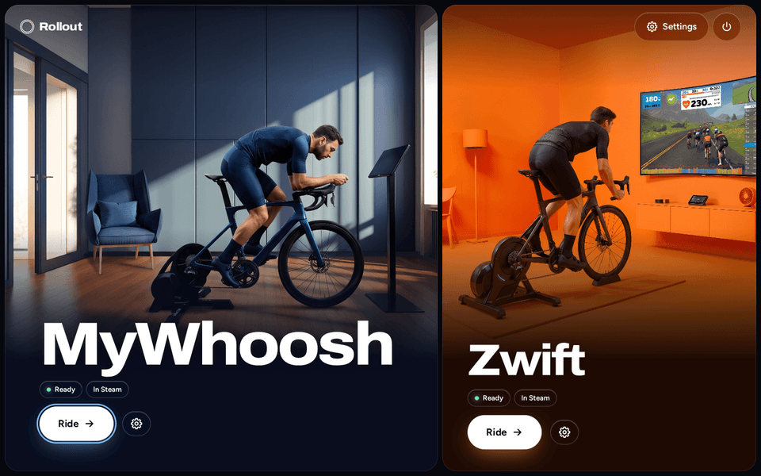
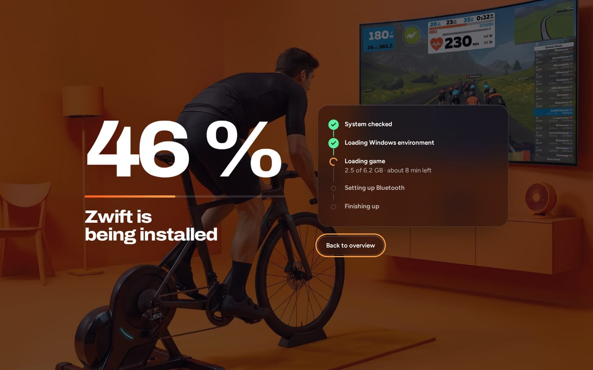
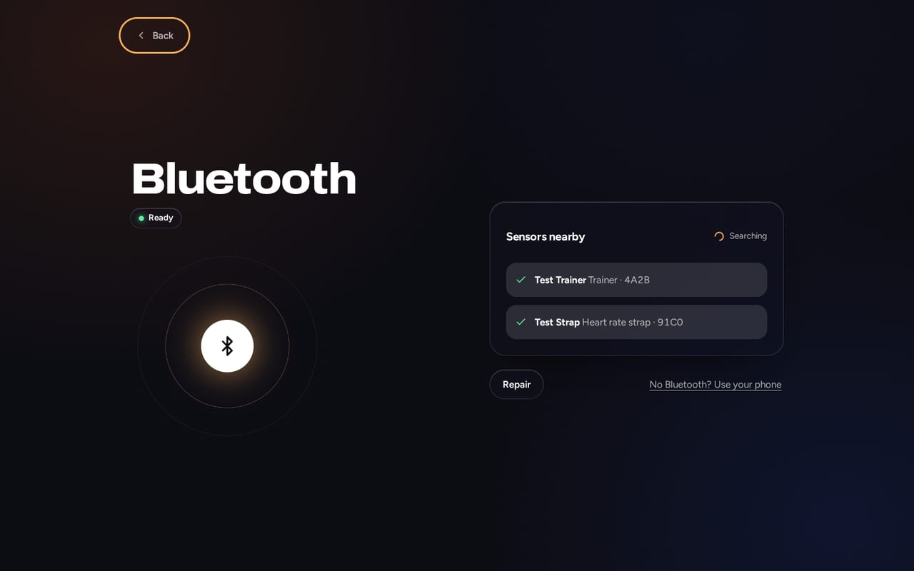
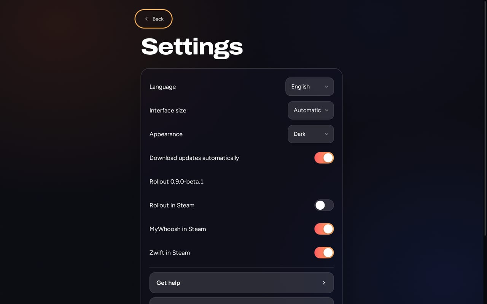
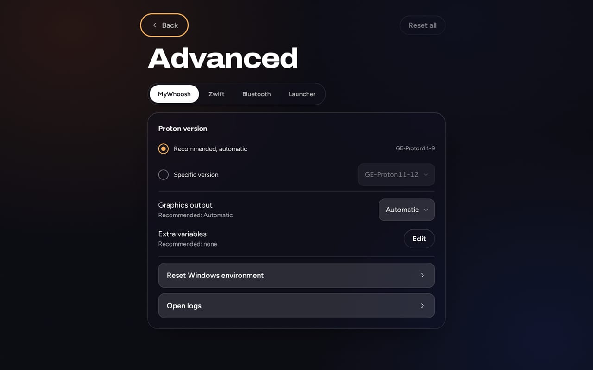

  <picture>
    <source media="(prefers-color-scheme: dark)" srcset="media/logo.svg">
    
  </picture>

<h1 align="center">Rollout</h1>

  <strong>MyWhoosh &amp; Zwift auf SteamOS und Bazzite. Herunterladen, doppelklicken, Losfahren.</strong>

  
  
  
  

  <a href="https://mace-ops.github.io/rollout-cycling-launcher-linux/de/"><b>Website</b></a> ·
  <a href="#installieren"><b>Installieren</b></a> ·
  <a href="#funktionen"><b>Funktionen</b></a> ·
  <a href="#faq"><b>FAQ</b></a> ·
  <a href="README.md">English</a>

  

Rollout ist ein Launcher, der **Indoor-Cycling-Apps unter Linux installiert, aktualisiert und startet**. Er ist für **SteamOS** (Steam Deck) und
**Bazzite** (ROG Ally und andere Handhelds, Desktop-PCs) gemacht und lässt sich komplett mit dem **Controller** bedienen, direkt aus dem Gaming Mode.

> [!NOTE]
> Rollout ist in der **Beta**. Getestet ist es an einem ROG Ally mit Bazzite. Das Steam Deck mit SteamOS ist das zweite Ziel und
> **noch nicht geprüft**. Andere Linux-Distributionen werden nicht unterstützt; Nutzung auf eigene Gefahr.

## Funktionen

| | |
| --- | --- |
| 🎮 **Controller zuerst** | Jeder Bildschirm geht mit Gamepad, Touch und Tastatur. Im Gaming Mode steuert der Controller auch Zwift. |
| ⚡ **Ein Knopf zum Installieren** | Keine Pflichtfragen, kein Terminal, kein `sudo`. Größe und Dauer vorab, dann klare Schritte mit Fortschritt. |
| 🔄 **Sichere Updates** | Rollout kann sich im Hintergrund selbst aktualisieren. Launcher-Updates sind signiert (Ed25519), werden zur Probe gestartet und gehen von selbst zurück, wenn die neue Version nicht startet. |
| 🕹️ **Steam-Anbindung** | Ein Schalter trägt Rollout und deine Apps mit Bildern in die Steam-Bibliothek ein. Fahrten aus dem Gaming Mode starten; die Spielzeit bleibt bei Updates erhalten. |
| 📡 **Bluetooth-Check** | Bei MyWhoosh: zeigt vor der Fahrt, welche Trainer (FTMS, Cycling Power) und Pulsgurte senden, und startet einen hängenden Adapter neu. |
| 🌍 **8 Sprachen** | English, Deutsch, Español, Français, Italiano, Português, Nederlands, Polski. Folgt der Systemsprache. |
| 🧑‍🦳 **Für alle** | Große Knöpfe, helles und dunkles Design, Größe der Oberfläche bis 200 %. Hinter „Erweitert“: Proton-Version, Grafik-Ausgabe, Bluetooth-Adapter, Update-Kanal, Logs, Diagnose. |

### Zwei Apps, jeweils die passende Einrichtung

| | MyWhoosh | Zwift |
| --- | --- | --- |
| Läuft mit | GE-Proton | Container von [netbrain/zwift](https://github.com/netbrain/zwift) (Podman oder Docker) |
| Sensoren | Direktes Bluetooth, gekoppelt im Spiel | Zwift Companion auf dem Handy oder Direct Connect (kein direktes Bluetooth im Container) |
| Controller im Spiel | Gamepad als Mauszeiger, von Rollout abgebildet (neu, am Handheld noch nicht geprüft) | Gamepad als Tastatur und Maus, von Rollout abgebildet |

## Screenshots

<table>
  <tr>
    <td></td>
    <td></td>
  </tr>
  <tr>
    <td align="center"><b>Installieren</b> – klare Schritte, ehrliche Zeitschätzung</td>
    <td align="center"><b>Bluetooth</b> – Sensoren vor der Fahrt finden</td>
  </tr>
  <tr>
    <td></td>
    <td></td>
  </tr>
  <tr>
    <td align="center"><b>Einstellungen</b> – Sprache, Updates, Steam</td>
    <td align="center"><b>Erweitert</b> – jede Option nennt die Empfehlung</td>
  </tr>
</table>

Die Screenshots zeigen die echte App (englische Oberfläche) mit simulierten Daten (kein Konto, kein laufendes Spiel).

## Installieren

  
  &nbsp;
  

> [!IMPORTANT]
> Der Download von `Rollout.desktop` ist noch nicht verfügbar. Die Knöpfe oben führen bis dahin zur Release-Seite.

1. In den **Desktop-Modus** wechseln (SteamOS: Steam-Taste → Ein/Aus → Zum Desktop wechseln; am PC mit Bazzite bist du schon dort).
2. `Rollout.desktop` herunterladen und in *Downloads* **doppelklicken**.
3. Die Rückfrage einmal bestätigen. Rollout steht danach im App-Menü.

Kein Terminal, kein Passwort. Rollout installiert sich nach `~/.local/share/rollout` und ändert keine Systempakete.

| System | Geräte | Stand |
| --- | --- | --- |
| **Bazzite** (KDE) | ROG Ally, andere Handhelds, Desktop-PCs | Beta, am ROG Ally getestet |
| **SteamOS** | Steam Deck LCD & OLED | Beta, **noch nicht geprüft** |
| Bazzite mit GNOME | – | Der Dateimanager startet heruntergeladene `.desktop`-Dateien nicht per Doppelklick, die Installation geht dort daher noch nicht |
| Andere Linux-Distributionen | – | nicht unterstützt, auf eigene Gefahr |

**Voraussetzungen:** 8–21 GB freier Platz je App (MyWhoosh 4 GB Download und 8 GB belegt, „Bessere Grafik“ 15 und 20 GB; Zwift etwa 6 GB Download und 20 GB belegt),
Internet für die erste Installation, Bluetooth für MyWhoosh-Sensoren. Zwift braucht Podman oder Docker: Podman ist in Bazzite enthalten, SteamOS bringt es meist nicht
mit, und Rollout installiert keine Systempakete. MyWhoosh braucht beides nicht.

## Controller

| Eingabe | In Rollout | In Zwift (Gaming Mode) |
| --- | --- | --- |
| Steuerkreuz · linker Stick · Pfeiltasten | Fokus bewegen | Pfeiltasten |
| **A** · Enter | Auswählen | Enter |
| **B** · Esc | Zurück | Esc |
| Rechter Stick | Scrollen | Mauszeiger |
| X · Y · Select · Start | – | Tab · Umschalt+Tab · Rücktaste · Esc |
| Trigger · LB/RB · R3 | – | Links-/Rechtsklick · Scrollen · Klick |

In MyWhoosh bildet Rollout das Gamepad stattdessen auf den Mauszeiger ab (Sticks bewegen ihn, **A** klickt). Das ist neu und am Handheld noch nicht geprüft, siehe [Entwicklerdoku](app/README.md).

## So funktioniert es

Rollout ist ein dünner Launcher. Er verändert keine Spiele, sondern steuert offene Projekte, die die schwere Arbeit schon machen:

- **MyWhoosh:** eigene Kopie von [Parapeth962/mywhoosh-linux-installer](https://github.com/Parapeth962/mywhoosh-linux-installer) (MIT), die den Bluetooth-Shim von [Dj0ulo/mywhoosh-linux](https://github.com/Dj0ulo/mywhoosh-linux) lädt.
- **Zwift:** [netbrain/zwift](https://github.com/netbrain/zwift), festgelegt auf Commit und SHA-256 in [`app/upstreams.json`](app/upstreams.json).
- **Launcher-Updates:** signiertes Manifest aus den GitHub Releases, atomarer Tausch, automatischer Rückweg.

Mehr: [Entwicklerdoku](app/README.md) · [Website](site/README.md).

## FAQ

<b>Läuft Zwift auf Steam Deck und Bazzite?</b>

Auf Bazzite ja: Zwift läuft in einem Container auf Basis von netbrain/zwift, den Rollout installiert und startet. Getestet ist Rollout an einem ROG Ally mit Bazzite;
das Steam Deck ist noch nicht geprüft. Auf SteamOS fehlt meist erst Podman oder Docker. Sensoren verbinden sich über Zwift Companion auf dem Handy oder Direct Connect,
nicht direkt per Bluetooth.

<b>Läuft MyWhoosh unter SteamOS und Linux mit Bluetooth?</b>

Ja. MyWhoosh läuft mit GE-Proton und spricht direkt per Bluetooth mit Trainer und Pulsgurt. Gekoppelt wird im Spiel, wie unter Windows.

<b>Läuft Zwift auf dem ROG Ally?</b>

Ja, unter Bazzite. Installiere Rollout im Desktop-Modus und starte Zwift dann in Rollout oder aus Steam im Gaming Mode. Dein Controller steuert das Spiel.

<b>Ist Rollout offiziell? Kann mein Konto gesperrt werden?</b>

Nein. Rollout ist ein unabhängiges Projekt und nicht mit Zwift, Inc., MyWhoosh oder Valve verbunden. Deren Bedingungen schränken nicht genehmigte Werkzeuge von Dritten ein,
und sie können Konten nach eigenem Ermessen sperren. Lies die Bedingungen und entscheide selbst.

<b>Welche Geräte und Systeme werden unterstützt?</b>

Rollout ist in der Beta. Getestet ist es an einem ROG Ally mit Bazzite. SteamOS auf dem Steam Deck ist das zweite Ziel, aber noch nicht geprüft. Andere Linux-Distributionen auf eigene Gefahr.

## Mitmachen

Fehlerberichte und Übersetzungen sind willkommen. Eine neue App-Sprache ist eine Datei in [`app/src/renderer/locales/`](app/src/renderer/locales/), eine neue
Website-Sprache eine Datei in [`site/i18n/`](site/i18n/). Siehe [Entwicklerdoku](app/README.md) und [Website-Anleitung](site/README.md).

## Lizenz

Rollout steht unter der [MIT-Lizenz](LICENSE). Fremde Komponenten behalten ihre Lizenz, siehe [THIRD_PARTY_LICENSES.md](THIRD_PARTY_LICENSES.md).

## Hinweis

Rollout ist nicht mit Zwift, Inc., MyWhoosh oder Valve verbunden und wird von ihnen weder unterstützt noch gesponsert. Alle Marken gehören ihren Inhabern. Fremde Werkzeuge
können den Nutzungsbedingungen der Apps widersprechen.
